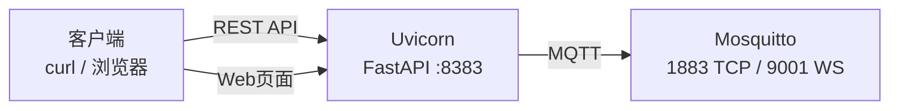

# MQTT 推送中心

基于 FastAPI + Mosquitto 的 MQTT 消息推送服务，提供 Web 管理界面和 REST API。

## 架构



- **Uvicorn** (`Port 8383`) — 提供 Web 页面和 REST API
- **Mosquitto** (`Port 1883` TCP, `Port 9001` WebSocket) — MQTT 消息代理

## 快速开始

启动后访问 `http://<host>:8383` 即可打开管理页面（前端为 Vue 构建产物，`main.py` 自动托管）。

### 前端本地开发

管理页面前端在 `前端/`（Vue 3 + Vite + Tailwind）。开发时先启动后端，再跑 dev server：

```bash
# 1. 启动后端
cd 容器相关脚本
uvicorn main:app --host 0.0.0.0 --port 8383

# 2. 启动前端 dev server（/api、/records 自动代理到后端）
cd 前端
npm install
npm run dev        # http://localhost:5180
```

生产构建：`cd 前端 && npm run build`，产物 `前端/dist` 由 `main.py` 直接托管。

### 自定义端口

通过环境变量修改端口：
`docker-compose.yml` 的 `environment` 中直接修改：

```yaml
environment:
  - MQTT_WS_PORT=8080
  - UVICORN_PORT=8888
```

## API 接口

### `POST /api/push` — 推送消息

**请求体：**

```json
{
  "server_name": "o1-debian-1",
  "topic": "server/khx-live",
  "title": "录播备份上传脚本",
  "message": "上传成功",
  "status": "ok",
  "push_to_mqtt": true,
  "msg_type": "markdown",
  "mode": "append"
}
```

| 字段 | 类型 | 必填 | 说明 |
|------|------|------|------|
| `server_name` | string | 是 | 来源服务器名称 |
| `topic` | string | 是 | 项目 / 服务主题，例如 `server/khx-live`；不需要重复 `server_name` |
| `title` | string | 是 | 项目里的脚本 / 任务名，例如 `录播备份上传脚本` |
| `message` | string | 是 | 脚本执行结果 / 详情（支持 Markdown） |
| `status` | string | 是 | 消息状态：`ok` / `warn` / `error` / `info`，TaskOps 服务页按它显示级别 |
| `push_to_mqtt` | bool | 是 | 是否推送到 MQTT（传 `true`/`false`，**不带引号**） |
| `msg_type` | string | 否 | 消息类型，固定 `"markdown"` |
| `mode` | string | 否 | `"append"`（持续追加，默认）或 `"overwrite"`（覆盖同一 `server_name` + `topic` + `title` 的记录） |

> 服务器上报的层级：`server_name` = 服务器，`topic` = 项目 / 服务，`title` = 项目里的脚本 / 任务。
>
> `mode=overwrite` 按 `server_name` + `topic` + `title` 三者匹配，同一项目下的不同脚本不会互相覆盖。
>
> `status` 是**消息自身**的状态；响应/记录里的 `push_result` 是 MQTT 投递结果（`success` / `failed` / `skipped`），两者不是一回事。

**响应：**

```json
{
  "code": 200,
  "record_id": 1,
  "status": "ok",
  "detail": "消息已投递至 MQTT"
}
```

### `POST /api/repush` — 重新推送

```json
{
  "server_name": "server-1",
  "id": 1
}
```

### `GET /records` — 查询历史

```
GET /records?server_name=server-1&topic=test&limit=50&offset=0
```

| 参数 | 类型 | 默认 | 说明 |
|------|------|------|------|
| `server_name` | string | — | 按服务器筛选 |
| `topic` | string | — | 按主题筛选（模糊匹配） |
| `limit` | int | 100 | 返回条数（1-500） |
| `offset` | int | 0 | 偏移量 |

### `GET /api/clients` — 查询客户端在线状态

管理页「客户端」标签使用该接口：

```json
{
  "total": 2,
  "online": 1,
  "clients": [
    {
      "client_id": "windows_1a2b3c4d",
      "suffix": "1a2b3c4d",
      "online": true,
      "platform": "windows",
      "topic": "taskops/todo/#",
      "name": "DESKTOP-ABC",
      "version": "1.0.0",
      "last_seen": "2026-11-06 03:30:00",
      "last_seen_epoch": 1793907000,
      "status_changed": "2026-11-06 03:10:00",
      "status_changed_epoch": 1793905800
    }
  ],
  "topic": "$presence/clients",
  "ttl_seconds": 180
}
```

客户端连接后向 `$presence/clients/{client_id}` 发布 retained JSON（含订阅主题 `topic`），
连接期间每 60 秒刷新一次 QoS1 心跳。`$` 开头的主题不会被业务订阅的 `#` 通配符匹配到，
所以不会触发客户端提醒。服务端超过 `PRESENCE_TTL_SECONDS`（默认 180 秒）收不到心跳时
会把客户端显示为离线。

Android 客户端已不再使用 MQTT Will，异常断线由 retained 心跳 + TTL 兜底，主动停止时实时
上报 `online=false`。对于仍使用 Will 的客户端（Windows / 旧版 Android），服务端会比较
payload 里客户端自己生成的 `ts`：比当前记录更旧的 `online=false` 会被丢弃，避免重连后
旧连接的 Will 迟到、把刚上线的设备误标成离线。

客户端以固定随机后缀作为设备唯一标识：同一个后缀即使自定义前缀改了，也会覆盖为同一台设备，
不会在管理页出现两条记录。`DELETE /api/clients/{suffix}` 只允许删除离线记录，
会同时清掉 broker 上的 retained 消息；设备下次上线后会重新上报并恢复显示。

### `GET /api/health` — 健康检查

```json
{ "status": "running" }
```

## 访问密码

设置环境变量 `APP_PASSWORD` 后，管理页会显示登录页，数据接口要求会话 Cookie（不设置则保持开放）：

| 变量 | 说明 |
| --- | --- |
| `APP_PASSWORD` | 访问密码；留空 = 不启用 |
| `APP_SECRET` | 会话 Cookie 签名密钥；留空则由密码派生 |
| `APP_SESSION_DAYS` | 会话有效天数，默认 `7` |
| `PUSH_SERVER_TOKEN` | 服务间调用令牌；TaskOps 读记录、写定时任务时携带 `X-Push-Token` |

放行规则：

- 登录接口、`/api/health`、前端页面与静态资源始终可访问；
- `/api/push`（服务器上报）和 `/api/task*`（TaskOps 待办同步）免登录，避免现有脚本失效；
- 其余 `/api/*` 和 `/records` 需要登录 Cookie，或携带正确的 `X-Push-Token`。

注意：这里只保护 HTTP 管理页与接口，MQTT 的 `1883` / `9001` 端口不在此范围内，请勿直接暴露公网。

`docker-compose.yml` 已接好这些变量，在仓库根目录放一个 `.env`（参考 `.env.example`）后 `docker compose up -d` 生效。

## 目录结构

```
.
├── docker-compose.yml       # 容器编排配置
├── Dockerfile                # 镜像构建
├── 前端/                     # Vue 3 + Vite + Tailwind 前端工程（重写后的管理页面）
│   ├── src/                  # 组件 / 视图 / 请求封装
│   └── dist/                 # 构建产物（npm run build 生成）
├── 容器构建脚本/
│   ├── init-components.sh    # 构建时初始化（下载 7z、应用文件；镜像内构建前端）
│   └── start.sh              # 容器入口脚本（启动 mosquitto + uvicorn）
├── 容器相关脚本/
│   ├── main.py               # FastAPI 应用（托管 /、/assets、前端构建产物）
│   └── api-docs.html         # 在线 API 文档页
└── data/                     # 运行时数据（自动创建）
    ├── main.py               # 应用文件（挂载自镜像）
    ├── static/               # 前端构建产物（挂载自镜像，start.sh 重铺）
    └── push_records/         # 推送记录 JSON 文件
```

> 前端构建产物由 `main.py` 自动识别并托管：容器里在 `data/static/`（`start.sh` 重铺），
> 本地开发布局在仓库内 `前端/dist`。旧版单文件 `index.html` 仍作为兜底保留。

## 数据存储

推送记录以 JSON 文件形式持久化在工作目录下，按 `server_name` 分文件存储，每个服务器最多保留 100 条记录。
