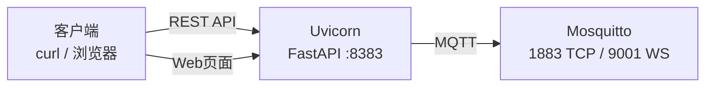

# MQTT 推送中心

基于 FastAPI + Mosquitto 的 MQTT 消息推送服务，提供 Web 管理界面和 REST API。

## 架构



- **Uvicorn** (`Port 8383`) — 提供 Web 页面和 REST API
- **Mosquitto** (`Port 1883` TCP, `Port 9001` WebSocket) — MQTT 消息代理

## 快速开始

启动后访问 `http://<host>:8383` 即可打开管理页面（前端为 Vue 构建产物，`main.py` 自动托管）。

### 前端本地开发

管理页面前端在 `前端/`（Vue 3 + Vite + Tailwind）。开发时先启动后端，再跑 dev server：

```bash
# 1. 启动后端
cd 容器相关脚本
uvicorn main:app --host 0.0.0.0 --port 8383

# 2. 启动前端 dev server（/api、/records 自动代理到后端）
cd 前端
npm install
npm run dev        # http://localhost:5180
```

生产构建：`cd 前端 && npm run build`，产物 `前端/dist` 由 `main.py` 直接托管。

### 自定义端口

通过环境变量修改端口：
`docker-compose.yml` 的 `environment` 中直接修改：

```yaml
environment:
  - MQTT_WS_PORT=8080
  - UVICORN_PORT=8888
```

## API 文档

完整接口说明统一维护在 **[API.md](API.md)**，包含：

- REST API、请求/响应字段、错误码
- 登录鉴权与 `X-Push-Token`
- 定时任务接口
- MQTT 连接参数、下行主题与 payload
- 客户端在线状态（presence）协议
- curl / Python 脚本示例

在线自动文档：

- `http://<host>:8383/api/docs`
- `http://<host>:8383/docs`
- `http://<host>:8383/openapi.json`

## 构建与部署（docker-image-template）

本仓库使用 [xct258/docker-image-template](https://github.com/xct258/docker-image-template)：
镜像只通过 GitHub Actions 构建，本地不需要安装 Docker。

1. Actions 页面 → **Build and Push Docker Image** → **Run workflow**；
2. 工作流运行 `bash check.sh`，按 `install/app.conf` 构建并推送 `xct258/push-server:latest`
   （每月 1 日也会自动构建）；
3. 服务器上执行：

```bash
docker compose pull
docker compose up -d
```

需要在仓库 Secrets 中配置 `DOCKERACC` / `DOCKERPWD`。

## 目录结构

```
.
├── API.md                   # 完整接口文档（REST / MQTT / presence）
├── install/                 # 构建期（docker-image-template）
│   ├── app.conf             # 镜像名 / 架构 / apt / pip 依赖
│   ├── install.sh           # 模板通用安装器
│   └── custom-install.sh    # 下载 Node 构建前端，拷贝后端到 /opt/push-server
├── startup/                 # 运行期
│   ├── prepare.sh           # 每次启动：同步代码/前端到 /data，生成 mosquitto 配置
│   ├── once.sh              # 只执行一次
│   ├── update.sh            # 自动更新（本仓库保持空操作）
│   └── main.sh              # 启动 mosquitto + uvicorn 并常驻
├── template/                # 模板固定的 Dockerfile 与 start.sh
├── check.sh                 # 本地自查（push 前运行）
├── docker-compose.yml       # 部署配置（host 网络 + ./data:/data）
├── 前端/                    # Vue 3 + Vite + Tailwind 前端工程
└── 容器相关脚本/            # FastAPI 后端源码（main.py / auth.py / api-docs.html）
```

> 前端构建产物由 `main.py` 自动识别并托管：容器里在 `/data/static/`（`prepare.sh` 重铺），
> 本地开发布局在仓库内 `前端/dist`。旧版单文件 `index.html` 仍作为兜底保留。
>
> 容器内应用目录从旧版的 `/rec` 改成了 `/data`；宿主机数据卷仍是 `./data`，
> `push_records/` 和 `tasks.json` 原样保留，升级不会丢数据。

## 数据存储

推送记录以 JSON 文件形式持久化在 `/data/push_records`（宿主机 `./data/push_records`），
按 `server_name` 分文件存储，每个服务器最多保留 100 条记录。定时任务在 `/data/tasks.json`。
