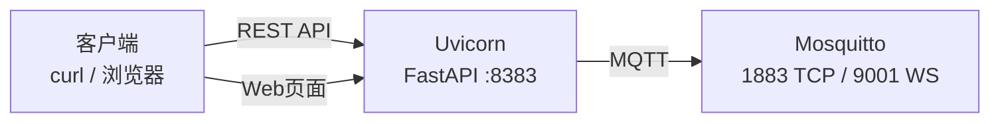

# MQTT 推送中心

基于 FastAPI + Mosquitto 的 MQTT 消息推送服务，提供 Web 管理界面和 REST API。

## 架构



- **Uvicorn** (`Port 8383`) — 提供 Web 页面和 REST API
- **Mosquitto** (`Port 1883` TCP, `Port 9001` WebSocket) — MQTT 消息代理

## 快速开始

启动后访问 `http://<host>:8383` 即可打开管理页面（前端为 Vue 构建产物，`main.py` 自动托管）。

### 前端本地开发

管理页面前端在 `前端/`（Vue 3 + Vite + Tailwind）。开发时先启动后端，再跑 dev server：

```bash
# 1. 启动后端
cd 容器相关脚本
uvicorn main:app --host 0.0.0.0 --port 8383

# 2. 启动前端 dev server（/api、/records 自动代理到后端）
cd 前端
npm install
npm run dev        # http://localhost:5180
```

生产构建：`cd 前端 && npm run build`，产物 `前端/dist` 由 `main.py` 直接托管。

### 自定义端口

通过环境变量修改端口：
`docker-compose.yml` 的 `environment` 中直接修改：

```yaml
environment:
  - MQTT_WS_PORT=8080
  - UVICORN_PORT=8888
```

## API 文档

完整接口说明统一维护在 **[API.md](API.md)**，包含：

- REST API、请求/响应字段、错误码
- 登录鉴权与 `X-Push-Token`
- 定时任务接口
- MQTT 连接参数、下行主题与 payload
- 客户端在线状态（presence）协议
- curl / Python 脚本示例

在线自动文档：

- `http://<host>:8383/api/docs`
- `http://<host>:8383/docs`
- `http://<host>:8383/openapi.json`

## 目录结构

```
.
├── API.md                   # 完整接口文档（REST / MQTT / presence）
├── docker-compose.yml       # 容器编排配置
├── Dockerfile                # 镜像构建
├── 前端/                     # Vue 3 + Vite + Tailwind 前端工程（重写后的管理页面）
│   ├── src/                  # 组件 / 视图 / 请求封装
│   └── dist/                 # 构建产物（npm run build 生成）
├── 容器构建脚本/
│   ├── init-components.sh    # 构建时初始化（下载 7z、应用文件；镜像内构建前端）
│   └── start.sh              # 容器入口脚本（启动 mosquitto + uvicorn）
├── 容器相关脚本/
│   ├── main.py               # FastAPI 应用（托管 /、/assets、前端构建产物）
│   └── api-docs.html         # 在线 API 文档页
└── data/                     # 运行时数据（自动创建）
    ├── main.py               # 应用文件（挂载自镜像）
    ├── static/               # 前端构建产物（挂载自镜像，start.sh 重铺）
    └── push_records/         # 推送记录 JSON 文件
```

> 前端构建产物由 `main.py` 自动识别并托管：容器里在 `data/static/`（`start.sh` 重铺），
> 本地开发布局在仓库内 `前端/dist`。旧版单文件 `index.html` 仍作为兜底保留。

## 数据存储

推送记录以 JSON 文件形式持久化在工作目录下，按 `server_name` 分文件存储，每个服务器最多保留 100 条记录。
