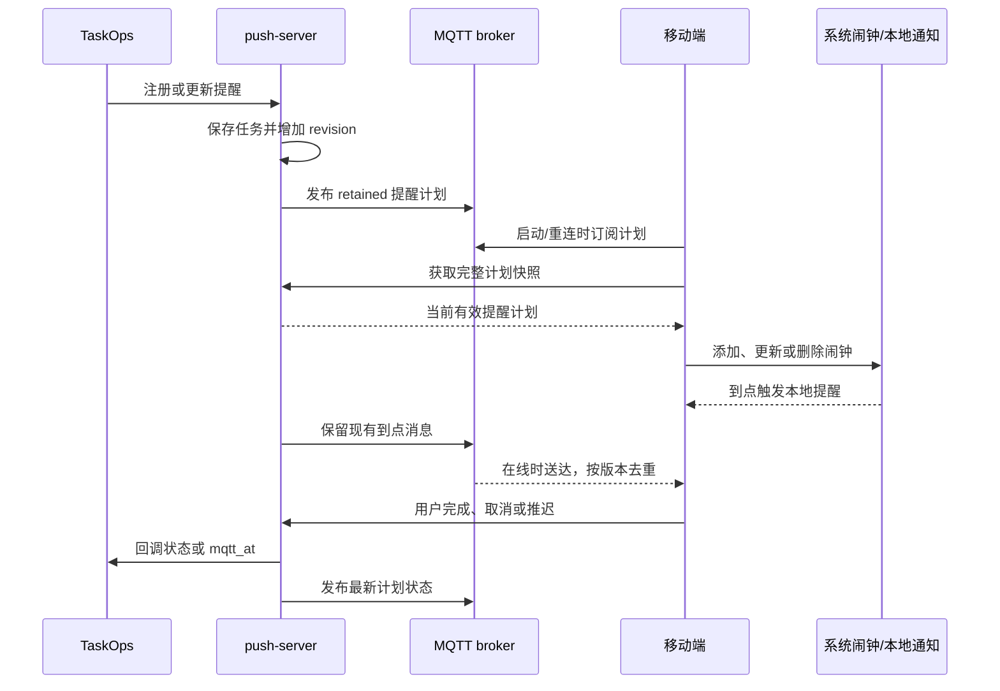
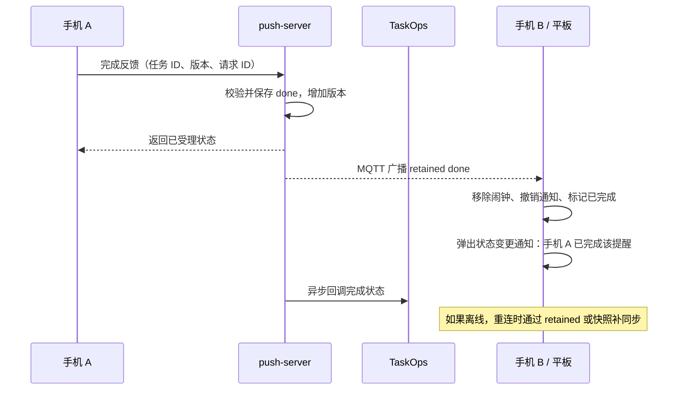

# 移动端本地闹钟同步实施计划

状态：push-server 服务端基础同步已实现；移动端闹钟和通知处理待实现。

当前实现：retained 计划广播、任务/快照版本、变更来源、完整快照、来源结束状态接口、反馈请求去重和版本冲突处理、发布失败重试及启动补发。broker 恢复通过每 5 分钟补发实现，尚未接入立即重连补发。反馈版本与请求 ID 暂为可选字段，以允许现有管理页面继续反馈；新设备客户端应携带两者。客户端撤回通知和弹层尚未实施。

## 1. 目标

移动端受省电策略限制，无法持续保持 MQTT 连接，现有的到点推送可能无法及时送达。

新增提前同步提醒计划的能力：TaskOps 注册或修改提醒后，push-server 保存计划并立即发布专用 MQTT 消息；移动端在启动、重连或周期唤醒时同步计划，提前设置系统闹钟或本地通知。

已同步的提醒由设备本地触发。新增计划仍需要设备成功连接并完成同步；后台周期唤醒的具体时机取决于移动端系统。

同一家庭的多个设备共享提醒状态：任何设备或 TaskOps 页面完成、取消、推迟或修改待办，push-server 都向所有订阅设备发布最新状态，其他设备据此更新本地闹钟和通知。

## 2. 总体流程



TaskOps 继续维护待办、到期日期、提醒日期和循环规则。push-server 维护本期 MQTT 排期。移动端只安排已同步的当前期提醒，不自行推算下一周期。

注册时立即发送计划消息，到达提醒时间后仍发送现有正常 MQTT 消息。到点消息表示“现在需要提醒”，不表示任务已完成；用户处理后才广播完成或取消状态。

### 2.1 多设备处理流程



状态广播与 TaskOps 回调分别重试，不等待回调成功才通知其他设备。管理页应分别显示计划发布状态和 TaskOps 回调状态，不能把“反馈已受理”当成“所有设备已同步”。

### 2.2 其他设备的状态变更通知

设备 A 完成、取消、推迟或修改提醒后，其他设备除了更新本地计划，还应弹出一条状态变更通知，告知用户发生了什么。

| 动作 | 其他设备上的通知示例 | 同时执行 |
| --- | --- | --- |
| 完成 | 手机 A 已完成「整理工具柜」 | 移除闹钟、撤销旧提醒通知 |
| 取消 | 手机 A 已取消「整理工具柜」 | 移除闹钟、撤销旧提醒通知 |
| 推迟 | 手机 A 将「整理工具柜」推迟至 10 月 20 日 21:30 | 替换闹钟 |
| 修改时间 | 手机 A 将「整理工具柜」的提醒时间改为 10 月 21 日 09:00 | 替换闹钟 |
| 修改内容 | 手机 A 更新了「整理工具柜」的内容 | 更新本地通知内容 |
| TaskOps 页面操作 | TaskOps 已完成/取消/更新「整理工具柜」 | 按对应动作更新计划 |

前台使用应用内通知弹层，后台使用系统通知；系统是否允许横幅弹出由通知权限、通知渠道和系统设置决定，不使用强制全屏弹窗。点击通知打开对应提醒详情，显示最新状态；已结束提醒不再提供基于旧版本的操作按钮。

### 2.3 先撤回旧提醒，再发送变更通知

Windows 和 Android 客户端收到状态变更后，先移除本应用为该任务发出的旧提醒通知，再发送新的状态变更通知。例如：

```text
所有设备收到：整理工具箱
    ↓
设备 A 点击完成
    ↓
其他设备收到 done 状态
    ↓
更新本地任务 → 取消闹钟 → 撤回“整理工具箱”旧通知
    ↓
发送：设备 A 已完成「整理工具箱」
```

采用以下规则减少通知数量：

- 一个任务最多保留一条当前提醒通知和一条最新状态变更通知；收到变更后，旧提醒通知被撤回。
- 同一任务后续再次变更时，使用相同的变更通知标识替换上一条变更通知，不累积多条。
- 完成和取消：取消闹钟、撤回旧提醒，再通知结束状态。
- 推迟：撤回旧提醒、替换闹钟，再通知新的提醒时间。
- 修改：撤回旧提醒、更新计划，再通知修改结果；不立即重发到点提醒。
- 设备 A 自身也撤回旧提醒，但不再发送其他设备操作提示。
- 重复收到相同事件时不重复通知；旧通知不存在时撤回操作视为已完成。
- 此处的“撤回”指客户端移除本应用的本地通知，不是删除 broker 消息或撤销已经送达的 MQTT 消息。

通知标识以服务范围和 task_id 组成稳定键，例如 `taskops:7`，并区分提醒与状态变更：

| 平台 | 提醒通知 | 状态变更通知 | 撤回方式 |
| --- | --- | --- | --- |
| Android | tag=`reminder:taskops:7`，固定整数 ID | tag=`change:taskops:7`，固定整数 ID | `NotificationManager.cancel(tag, id)` |
| Windows | 固定 Group，Tag 使用 task_id 的稳定短标识 | 独立 Group，Tag 使用同一任务的短标识 | 按 Tag/Group 从本应用通知历史中移除 |

Windows Tag/Group 按所用通知 API 的长度限制编码，不直接使用可能超长的业务字符串；保存业务键与通知标识的映射。客户端还须持久化闹钟/计划通知标识，完成和取消时同时取消未来的计划通知，不能只删除通知中心里已经显示的通知。

撤回旧通知通常不能撤销已经播放的声音或已经被用户看到的横幅。客户端离线时也无法立即撤回，恢复联网并接收状态后执行清理。通知去重、撤回和替换均在所属应用的通知范围内进行。

通知规则：

- 发起操作的设备不再收到一条远端变更通知，本地操作成功提示仍保留。
- 其他已同步该任务的设备收到新变更时提示；首次安装、首次同步的历史计划不逐条弹窗。
- 以事件 ID 去重，并持久化处理进度，MQTT 重传、重连收到 retained 消息以及快照对账不会重复弹窗。
- 默认状态变更通知不响铃、不震动，避免多设备同时发声；到点提醒仍按闹钟通知设置执行。
- 在线时逐次提示；离线恢复时只提示最近一次可恢复的变更。多条变化合并成一条通知，例如“有 3 条提醒状态已更新”，点击查看更新列表。
- retained 消息仅保存最新状态，不用于保存完整操作历史。第一版不承诺补发离线期间每一次变更；若后续需要完整历史通知，再增加事件日志和增量拉取接口。
- 撤销旧的到点提醒通知与发送新的状态变更通知使用不同通知 ID，防止误撤销刚发出的变更通知。
- 处理顺序固定为本地状态更新、取消或替换闹钟、撤回旧提醒、发送或替换变更通知；同一任务的并发处理串行执行，发送前检查版本，防止旧事件清理或覆盖新通知。

## 3. MQTT 主题与消息协议

### 3.1 主题

| 主题 | 用途 | QoS | Retain |
| --- | --- | --- | --- |
| `taskops/todo/{task_id}` | 现有到点提醒，继续使用纯文本 | 1 | false |
| `taskops/schedule/{task_id}` | 当前提醒计划或结束状态 | 1 | true |

计划主题基础路径使用环境变量 `SCHEDULE_TOPIC`，默认 `taskops/schedule`。移动端订阅 `taskops/schedule/+`。

现有到点纯文本消息保持兼容。第一版使用计划中保存的版本以及任务状态做去重；若设备无法可靠区分纯文本消息所属期次，可只用到点消息触发补同步，不直接再次弹出通知。后续可增加独立的 JSON 到点事件主题，显式携带任务版本。

### 3.2 有效计划

```json
{
  "schema_version": 1,
  "task_id": 7,
  "client_ref": "todo-123",
  "server_name": "taskops",
  "revision": 3,
  "snapshot_version": 41,
  "status": "active",
  "schedule_at": "2026-10-20T20:30:00+08:00",
  "title": "整理工具柜",
  "message": "清点工具和耗材",
  "updated_at": "2026-10-13T14:00:00+08:00"
}
```

- `schema_version`：协议版本。
- `task_id`：push-server 任务 ID，同一个任务的更新覆盖同一主题。
- `revision`：任务计划版本，必须持久化，更新时单调增加。
- `status`：同步协议状态，取值 `active`、`done`、`cancelled`。
- `schedule_at`：完整 ISO 日期时间，携带时区；服务端统一为北京时间。
- `title`、`message`：移动端本地通知标题和内容。
- `client_ref`：关联 TaskOps 待办，不代替 task_id 作为闹钟标识。

所有计划变更消息增加 `change` 对象，有效计划和结束消息均携带：

```json
{
  "change": {
    "event_id": "task-7-revision-4",
    "action": "done",
    "source": "device",
    "device_id": "device-a",
    "device_name": "手机 A",
    "changed_at": "2026-10-13T14:10:00+08:00"
  }
}
```

`change.action` 取值 `created`、`updated`、`done`、`cancelled`、`snooze`；updated 可增加 `fields` 数组说明修改了 schedule_at、title 或 message。event_id 在同一变更的重发中保持一致，任务每增加 revision 生成一个新事件。source 为 device、taskops 或 push_web；只有 device 来源携带设备信息，设备名称不作为身份或权限依据。

结束消息也保留任务 title，供其他设备显示通知；推迟消息包含新 schedule_at。变更元数据与计划一起持久化、发布并包含在快照任务记录中。创建事件用于同步闹钟，默认不弹出“其他设备修改状态”通知。

每个任务使用独立主题，不使用单一 retained 主题存放所有任务的增量事件，否则后来的消息会覆盖先前任务。

### 3.3 结束状态

```json
{
  "schema_version": 1,
  "task_id": 7,
  "client_ref": "todo-123",
  "server_name": "taskops",
  "revision": 4,
  "snapshot_version": 42,
  "status": "cancelled",
  "updated_at": "2026-10-13T14:10:00+08:00"
}
```

结束状态必须发布 retained 消息，通知离线期间已保存旧闹钟的设备删除闹钟。不能只删除 retained 消息。

结束消息暂定保留 7 天，之后用空 payload 清除 broker retained 消息。完整快照负责清理错过结束消息的本地提醒。

## 4. 服务端数据与变更触发

任务新增以下持久化字段：

| 字段 | 用途 |
| --- | --- |
| `revision` | 计划版本 |
| `schedule_sync_revision` | 已成功发布的计划版本 |
| `schedule_sync_retry` | 当前同步失败次数 |
| `schedule_sync_next_at` | 下次发布重试时间 |
| `terminal_at` | 结束时间，用于 retained 清理 |
| `change` | 最近一次变更事件、操作来源和通知文案所需信息 |

任务库增加 `snapshot_version`，计划发生变化时单调递增。它与已有存储版本分别定义：普通回调重试计数更新不应改变计划版本。

| 变更 | 服务端处理 | 移动端处理 |
| --- | --- | --- |
| 注册提醒 | 保存 active 计划并发布 | 新建闹钟 |
| 修改日期时间 | 增加 revision 并发布 | 替换闹钟 |
| 修改标题/内容 | 增加 revision 并发布 | 更新通知内容 |
| 推迟 | 更新 schedule_at、增加 revision | 重新安排闹钟 |
| 用户完成 | 发布 done | 删除闹钟 |
| 用户取消 | 发布 cancelled | 删除闹钟 |
| TaskOps 页面完成 | 发布 done，不反向回调 TaskOps | 删除闹钟并显示已完成 |
| TaskOps 删除/关闭 MQTT | 发布 cancelled，不反向回调 TaskOps | 删除闹钟 |
| 循环任务完成后注册下一期 | 按实际任务 ID 发布下一期计划 | 安排下一期闹钟 |
| 到点发布成功，pending 变 sent | 继续视为未处理的 active 计划 | 按补提醒规则处理 |

相同字段的重复 upsert 不增加 revision。真正的重新排期或重新激活终态任务必须增加 revision。

先持久化计划，再异步发布；发布失败不回滚已保存任务，进入发布重试。保存成功的接口响应只代表注册成功，不能声称设备已经设置闹钟。

### 4.1 TaskOps 操作必须保留状态语义

目前 TaskOps 的一次性完成、删除和关闭 MQTT 都可能调用同一个取消同步接口。新协议必须区分这些操作，否则其他设备会把完成显示成取消。

- TaskOps 页面完成：向 push-server 同步 `done`。
- TaskOps 删除、关闭 MQTT：向 push-server 同步 `cancelled`。
- TaskOps 修改或推迟：同步新的 active 计划。
- 设备反馈：push-server 广播状态，并异步回调 TaskOps。
- TaskOps 主动同步：push-server 广播状态，但不反向回调，防止同步循环。

实施时增加来源同步结束状态的接口，例如 `PUT /api/task/{task_id}/state`，请求体为 `{"status":"done"}` 或 `{"status":"cancelled"}`；该接口只处理调用方状态同步，使用现有 token 鉴权。现有 DELETE 继续表示取消。

循环任务完成时必须先结束当前期，再注册下一期。新一期使用新的 task_id，避免复用同一个任务 ID 后旧设备的反馈误操作下一期。

### 4.2 多设备重复反馈与冲突

设备反馈新增 `revision` 和 `request_id`，可选 `device_id` 用于追踪来源：

```json
{
  "task_id": 7,
  "revision": 3,
  "request_id": "device-a-unique-request-id",
  "device_id": "device-a",
  "device_name": "手机 A",
  "action": "done"
}
```

- request_id 在重试时保持不变；服务端持久化去重记录，重复请求返回原结果，不再次推进循环或累计推迟。
- 服务端在同一临界区校验版本并修改状态；多个设备同时处理时，第一个有效操作生效。
- 旧版本反馈不覆盖新计划。REST 返回 409 和当前计划；MQTT 上行无法直接返回 HTTP 状态，应重新发布当前 retained 计划供设备校正。
- 已终态任务的重复完成或取消不改变结束原因，也不再次回调 TaskOps。
- 每个设备的 MQTT client_id 必须唯一，避免连接互相踢下线。
- 状态主题使用普通订阅，不使用共享订阅；共享订阅只向其中一个设备投递，不适合广播。

## 5. 完整快照接口

新增：

```text
GET /api/schedules?server_name=taskops
```

```json
{
  "schema_version": 1,
  "snapshot_version": 42,
  "server_time": "2026-10-13T14:15:00+08:00",
  "tasks": [
    {
      "task_id": 7,
      "client_ref": "todo-123",
      "server_name": "taskops",
      "revision": 3,
      "status": "active",
      "schedule_at": "2026-10-20T20:30:00+08:00",
      "title": "整理工具柜",
      "message": "清点工具和耗材",
      "updated_at": "2026-10-13T14:00:00+08:00"
    }
  ],
  "terminal_tasks": []
}
```

- 返回完整的当前有效计划，包含 `pending` 和 `sent`，不包含 `done`、`cancelled`。
- 快照不能沿用 `/api/tasks` 默认 100 条截断；第一版一次返回完整集合，后续若分页，客户端必须获取全部分页后再对账。
- 使用现有 `X-Push-Token` 规则保护接口，令牌通过配置提供。
- 有效计划可能已经过期，是否补提醒由移动端根据 server_time 和补提醒窗口决定。
- 增加 `terminal_tasks` 数组，返回保留期内的结束记录（task_id、revision、snapshot_version、done/cancelled、updated_at），供离线设备区分已完成和已取消。它与 `tasks` 在同一次一致性读取中生成。
- tasks 和 terminal_tasks 均返回 title 及最近一次 change，供已同步过该任务的设备在恢复联网时展示更新通知；请求失败或不完整时不推进通知处理进度。

移动端对账规则：服务器新增则添加，版本变化则更新，本地有但完整快照没有则删除。只有快照成功且完整时，才允许执行缺失删除。

设备先应用 `terminal_tasks` 的明确结束状态，再清理两个集合中都不存在的本地提醒。超过结束记录保留期且仅凭快照缺失时，只能标记“提醒已移除”，不能猜测为已完成或已取消。

同步期间先订阅并缓存 MQTT 消息，再获取快照、应用快照、处理缓存。实时消息和快照都携带 `snapshot_version`，客户端保留每个任务最近应用的全局版本，并记录完整快照版本下界；丢弃低于下界的旧 MQTT 消息，防止取消任务被旧 retained active 消息重新创建。

任务 revision 用于同一任务去重，全局 snapshot_version 用于快照和 MQTT 的先后排序。

## 6. 移动端本地处理

本地持久化 task_id、revision、schedule_at、标题、内容、已触发标记和最近应用的 snapshot_version。

1. 启动、重连、周期唤醒时执行完整同步。
2. active 新版本替换本地闹钟，相同版本不重复创建。
3. done/cancelled 删除闹钟、撤销已展示通知，并保存版本和结束原因，阻止旧消息重新激活。
4. 到点记录该 task_id/revision 已提醒，重复到点消息不重复通知。
5. 设备重启后读取持久化计划并重新安排系统闹钟。
6. 通知点击和用户反馈关联 task_id；推迟后等待同步新版本。
7. 接收其他设备的推迟状态时替换旧闹钟；收到完成/取消时同步更新页面状态。
8. 离线设备不承诺已反馈成功。联网后发送带原 revision 和 request_id 的操作，按服务端返回的当前状态校正本地显示。
9. 来自其他设备或 TaskOps 的新变更按 2.2 节弹出通知；先完成本地状态更新，再发送状态变更通知，并保存已处理 event_id。
10. Windows 和 Android 按 2.3 节先撤回旧提醒，再发送/替换变更通知；本地闹钟触发前检查当前版本和终态，防止处理状态变更后旧闹钟再次发出通知。

补提醒窗口第一版暂定 30 分钟：未来计划安排闹钟；过去 30 分钟内未提醒的计划立即补提醒一次；更早的计划展示为错过提醒，不连续弹出通知。只有真正修改计划后才重置已提醒标记。

Android 需要处理通知权限、精确闹钟权限和开机恢复。iOS 使用本地通知，后台唤醒时机由系统决定，需处理系统允许的待安排通知数量上限。服务端能力和客户端平台实现分开验收。

## 7. 异常恢复

- MQTT 发布失败：待同步 revision 保留，指数退避重试，重连后优先补发。
- push-server 重启：从任务库重建全部 retained 计划，不能只依赖内存队列。
- broker 重启：恢复连接后重新发布有效计划和仍在保留期内的结束消息。
- 设备同步失败：保留已保存的计划，不以请求失败结果清空闹钟。
- 重复/乱序消息：按 snapshot_version 和 revision 丢弃旧消息。
- 终态清理：结束消息保留期结束后清除 retained，再用完整快照修正长期离线设备。
- 多任务并发更新：任务保存与版本增加使用同一临界区，发布确认不得覆盖更高版本的待同步状态。
- 多设备离线：设备在恢复联网之前可能触发旧闹钟，无法通过 MQTT 即时阻止；恢复联网后删除旧闹钟并撤销旧通知。
- 用户点开过时通知：联网时先检查最新状态，已结束的任务不再次反馈；无法联网时清楚显示本地状态尚未同步。

## 8. 分阶段实施

### 第一阶段：push-server 计划协议

- [x] 定义统一计划消息构造函数，明确状态映射。
- [x] 添加任务 revision、发布状态和 snapshot_version。
- [x] 实现独立 retained 计划主题，QoS 1。
- [x] 接入注册、更新、推迟、完成和取消路径。
- [x] 区分 TaskOps 主动完成与取消，防止状态被统一映射成 cancelled。
- [x] 循环任务先结束当前期再注册新 task_id。
- [x] 增加 revision 校验和 request_id 持久化去重。
- [x] 计划与结束消息增加 change 元数据及 title，快照返回相同信息。
- [x] 实现完整快照接口及鉴权。
- [x] 更新管理页面，分别显示任务回调状态和计划发布状态。
- [x] 更新协议文档和客户端示例。

### 第二阶段：可靠同步

- [ ] 实现失败重试、服务启动和 broker 重连补发。
- [x] 实现结束消息保留及 retained 清理。
- [ ] 验证多任务、同任务并发修改和版本排序。
- [ ] 验证状态消息广播到所有普通订阅设备，client_id 各自独立。
- [x] 验证服务端快照无截断。
- [ ] 客户端验证取消后的旧消息无法重新创建提醒。

### 第三阶段：移动端

- [ ] 实现计划订阅和完整快照对账。
- [ ] 实现本地持久化和系统闹钟/本地通知。
- [ ] 实现通知去重、补提醒窗口和重启恢复。
- [ ] 接入现有 done/cancelled/snooze 反馈协议。
- [ ] 反馈带上 revision、request_id，收到结束状态后撤销通知和闹钟。
- [ ] 实现其他设备操作的前台弹层、后台系统通知、事件去重和离线批量提示。
- [ ] 区分闹钟通知 ID 与状态变更通知 ID，操作设备不重复提示。
- [ ] 实现 Windows Tag/Group 与 Android tag/id 的稳定映射，撤回旧提醒并替换同任务变更通知。
- [ ] 串行处理同任务的通知变更，验证闹钟触发与状态更新竞态。
- [ ] 验证省电模式、断网、重连和设备重启。

## 9. 验收用例

| 场景 | 预期结果 |
| --- | --- |
| 在线注册未来提醒 | 立即收到计划，设备设置闹钟 |
| 设备离线时注册多条提醒 | 重连后恢复全部计划，不只收到最后一条 |
| 设备离线时修改/取消提醒 | 同步后旧闹钟被更新/移除 |
| 同一 retained 消息重复收到 | 不创建重复闹钟 |
| 旧版本在新版本之后送达 | 新版本不被覆盖 |
| MQTT snooze | mqtt_at 回写 TaskOps，设备安排新时间 |
| TaskOps 删除 | 发布 cancelled，不触发无意义回调 |
| push-server 或 broker 重启 | 从持久化任务恢复计划消息 |
| 完整快照请求失败 | 本地已有闹钟继续保留 |
| 计划数量超过 100 | 完整同步所有任务 |
| 本地闹钟触发后收到到点消息 | 不重复提醒 |
| 循环任务完成 | 同步下一期，客户端不自行计算周期 |
| 手机 A 完成、手机 B 在线 | B 收到 done，移除闹钟和通知，显示已完成 |
| 手机 A 取消、手机 B 离线 | B 重连后收到 cancelled 或快照结束记录，显示已取消 |
| 手机 A 推迟、平板在线 | 平板替换闹钟，不再按旧时间提醒 |
| TaskOps 页面完成 | 所有设备收到 done，不被误标为取消 |
| 多设备同时反馈同一版本 | 仅一个操作生效，冲突设备获取当前状态 |
| 同一推迟 request_id 重试 | 只推迟一次 |
| 旧通知反馈上一期循环任务 | 不影响新一期任务 |
| 结束记录已超保留期 | 快照移除本地提醒，不猜测结束原因 |
| 手机 A 完成，手机 B 在前台 | B 更新状态后弹出“手机 A 已完成”提示 |
| 手机 A 推迟，手机 B 在后台 | B 更新闹钟并发送含新时间的系统通知 |
| 操作设备收到自己的广播 | 不再弹出远端状态变更通知 |
| 状态消息重复或 retained 重放 | 同一 event_id 只提示一次 |
| 首次安装同步大量历史任务 | 创建计划，不逐条弹出历史变更通知 |
| 离线期间多个任务变化 | 重连后合并提示，并可查看各任务最新变更 |
| 系统禁止通知横幅 | 应用状态正常同步，前台显示提示，不承诺后台弹窗 |
| 所有设备收到“整理工具箱”，A 完成 | 其他在线设备先撤回旧提醒，再显示 A 已完成的通知 |
| 同一任务连续推迟、修改、完成 | 通知中心只保留该任务最新变更通知 |
| 旧提醒通知已被手动清除 | 撤回无错误，新变更通知正常显示 |
| A 完成时旧闹钟同时触发 | 版本/终态检查阻止旧提醒重新出现 |
| Windows/Android 重启后接收完成状态 | 使用持久化标识清理旧通知和计划通知 |

## 10. 实施边界

第一版针对现有单家庭 TaskOps 部署，不新增用户管理。多家庭场景需增加主题命名空间、设备权限和 broker ACL，并将快照限定到对应家庭。

不承诺移动系统必定按周期唤醒。验收目标是：成功同步的计划可本地提醒，恢复联网后计划能够正确对账，结束或修改的计划不会长期残留。
